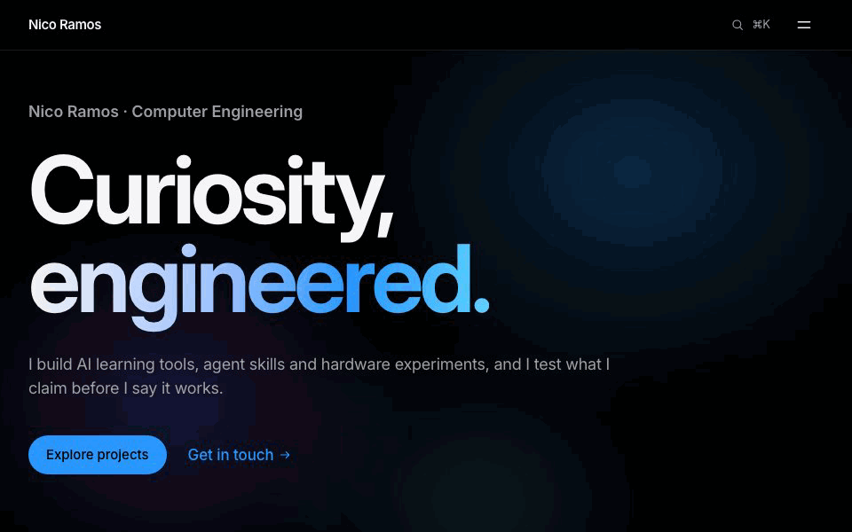

# itsnico.dev

My personal site. One page, nine sections, built with Next.js and deployed on Netlify.

**Live at [itsnico.dev](https://itsnico.dev)**



## What's on it

I'm Nico Ramos, a Computer Engineering transfer student from Vancouver Island University. The site shows what I build, in this order:

1. **Curiosity, engineered.** The hero.
2. **ProofLab.** My math learning project: the AI tutor teaches, a deterministic checker grades. A built-in replay shows a real check, step by step.
3. **AI systems.** The ProofLab tutor harness and hardware-bringup, a Claude Code skill that stops agents from claiming hardware works when they have never seen it.
4. **Hardware lab.** Bench cards, the bring-up loop on a 4-DOF Arduino arm, and the ArduinoUNO repo, labelled honestly as empty.
5. **Engineering & CS.** AI Engineering from Scratch (open source, by Rohit Ghumare, which I am studying), CyberBank, and this site.
6. **Photography.** Built and ready; photos are on their way.
7. **About me.** How curiosity started it all, plus a little chemistry humor.
8. **Learning archive.** VIU coursework (CSCI 162, 161, 159, 115) and other practice.
9. **Contact.** Email, GitHub and LinkedIn first, socials after.

Every project claim on the page is checked against its GitHub repository. If a repo is empty or a feature is not built yet, the site says so.

Press <kbd>⌘K</kbd> (or <kbd>Ctrl K</kbd>) on the site to jump anywhere.

## Built with

| Layer | Choice | Why |
|---|---|---|
| Framework | Next.js 16, App Router, React 19 | Server Components by default and static prerendering, with built-in image, font and metadata handling |
| Language | TypeScript, strict (plus `noUncheckedIndexedAccess`, `exactOptionalPropertyTypes`) | Content is data, so the types catch a missing field before the page does |
| Styling | Tailwind CSS v4 with CSS theme tokens | One token set, cinematic dark sections and deliberate light ones, no theme toggle |
| Motion | CSS only: scroll-driven reveals and transitions | No animation library in the bundle; everything respects `prefers-reduced-motion` |
| Fonts | Inter and JetBrains Mono via `next/font` | Self-hosted at build time, no layout shift, no request to Google |
| Icons | Inline SVG (Simple Icons, CC0) | No icon font, no CDN |
| Tests | Node test runner, Playwright, axe-core | Fast checks on content, real-browser checks on behaviour and accessibility |
| Hosting | Netlify with its Next.js runtime | Deploys on every push to `main`; images go through Netlify's image CDN |

No backend, no database, no auth, no contact form.

---

## Developer guide

### Quick start

Needs Node.js 20.9 or newer (Netlify builds with Node 24).

```bash
npm install
```

```bash
npm run dev
```

Then open http://localhost:3000.

To run the production build the way Netlify serves it:

```bash
npm run build && npm start
```

### Checks

| Command | What it does |
|---|---|
| `npm run typecheck` | Strict TypeScript, no emit |
| `npm run lint` | ESLint with the Next.js core-web-vitals and TypeScript rules |
| `npm test` | Unit tests on Node's built-in runner (TypeScript runs directly): palette search, content integrity, contacts against the GitHub profile README, no em dashes in copy |
| `npm run test:e2e` | Playwright on desktop and a Pixel 7 against the production build: axe (WCAG 2.2 AA), keyboard and palette flows, the ProofLab replay, security headers, SEO tags, in-page anchors, the 404 page, no horizontal scroll from 320 to 1440px, no console errors |
| `npm run check:links` | Fetches every external link in `src/content` and fails on anything broken (LinkedIn blocks bots with HTTP 999, so open that one by hand) |
| `npm run verify` | Typecheck, lint, unit tests and build in one go |

The first e2e run needs a browser:

```bash
npx playwright install chromium
```

### How it works

The page is prerendered to static HTML. Only four components run in the browser:

| Client component | Job |
|---|---|
| `SiteHeader.tsx` | Active-section highlight, mobile menu |
| `CommandPalette.tsx` | <kbd>⌘K</kbd> palette on a native `<dialog>`, ARIA combobox and listbox, fuzzy search |
| `ProofLabReplay.tsx` | Replays a real ProofLab `/check` response with CSS transitions. The server renders the finished state, so nothing is hidden without JavaScript |
| `CopyEmailButton.tsx` | Copies the email address and announces it to screen readers |

Everything else is a Server Component.

```
src/
  app/
    layout.tsx           fonts, metadata, JSON-LD, skip link, header, palette, footer
    page.tsx             the nine sections, in order
    globals.css          Tailwind theme tokens, section themes, scroll reveal, replay transitions, reduced motion
    opengraph-image.tsx  social card, rendered to a static PNG at build time
    robots.ts, sitemap.ts, not-found.tsx
  components/
    sections/            Hero, ProofLab, AISystems, HardwareLab, Engineering,
                         Photography, About, LearningArchive, Contact
    SiteHeader.tsx, CommandPalette.tsx, ProofLabReplay.tsx, CopyEmailButton.tsx
    Icon.tsx, ui.tsx     inline SVG icons, Section, SectionHeader, links, tags, status pills
  content/               every piece of copy and every link, as typed data
  lib/fuzzy.ts           the palette's matcher, dependency-free and unit tested
  assets/                images imported through next/image
tests/
  unit/                  node --test
  e2e/                   Playwright + axe
scripts/check-links.ts
docs/site-tour.gif       the recording at the top of this README
```

### Editing content

All copy lives in `src/content/`. Components only lay it out.

| To change | Edit | Rule |
|---|---|---|
| A project | `projects.ts` | Re-read the repo first and update the entry's `sources` list. Never invent features, stats or status |
| Contacts | `site.ts` and the expected list in `tests/unit/content.test.ts` | Both must match my [GitHub profile README](https://github.com/itsnicoramos/Itsnicoramos) |
| About me | `about.ts` | |
| Learning archive | `archive.ts` | Newest first. CSCI 161 and 162 stay unlinked on purpose |
| Photos | Add the file to `public/photography/`, then `{ src, alt, width, height }` to `photos.ts` | Real pixel sizes and descriptive alt text. While the list is empty the section shows an "in progress" state |
| Section order | `src/app/page.tsx` and `nav` in `site.ts` | Keep them in the same order |

Copy uses no em dashes; a unit test enforces it.

### Security

Headers are set in `next.config.ts`, so they behave the same locally and on Netlify:

- A Content Security Policy that allows only this origin, plus Netlify's analytics collector in `connect-src` so Netlify's real-user monitoring can report.
- `frame-ancestors 'none'`, HSTS, `nosniff`, a strict referrer policy and a locked-down permissions policy.
- `script-src` keeps `'unsafe-inline'` because Next.js hydrates with small inline scripts. Removing it would mean per-request nonces and giving up static rendering.

Every external link opens in a new tab with `rel="noopener noreferrer"`. A new external origin needs a CSP change and a reason.

### Deployment

Every push to `main` deploys to production. I run the checks locally, then push:

```bash
npm run verify && npm run test:e2e && npm run check:links
```

```bash
git push origin main
```

Then confirm https://itsnico.dev loads the change. Netlify settings live in `netlify.toml`:

| Setting | Value |
|---|---|
| Build command | `npm run build` |
| Publish directory | `.next` |
| Node | 24 |
| Plugin | `@netlify/plugin-nextjs` |

The plugin is declared on purpose. This Netlify site was created for the old Vite version, so Netlify does not auto-detect Next.js. Without the plugin it publishes the raw `.next` folder and every page returns 404.

### Troubleshooting

**Builds or `git` hang with 0% CPU.** The repo lives in an iCloud-synced Desktop folder, and when the disk runs low iCloud offloads files, so every read waits on a download. Generated folders are marked so iCloud ignores them. After a fresh clone or a deleted `node_modules`, mark them again:

```bash
mkdir -p node_modules .next && xattr -w 'com.apple.fileprovider.ignore#P' 1 node_modules .next
```

Then run `npm install` again. Keeping more free disk space helps too.

---

## Status

Live and maintained. The photography gallery is built but empty until I add photos. ArduinoUNO is shown as an empty repository, because it is one.

## License

All rights reserved. The code is public to read, but please ask before reusing it. The copy, the portrait and project descriptions are mine; AI Engineering from Scratch is Rohit Ghumare's MIT-licensed work, credited on the site.
